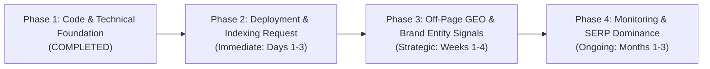

# Prioritized SEO, AEO & GEO Action Plan — PurePixel Studio
**Author:** PurePixel Lead SEO Strategist (via `Agentic-SEO-Skill`)  
**Target:** https://ai-content-remover.pages.dev/  
**Objective:** Secure #1 Organic Ranking on Google & Dominant Citation in ChatGPT Search, Claude, Gemini & Perplexity.

---

## 📅 Roadmap Overview



---

## Phase 1: Code & Technical Optimization (✅ COMPLETED)

All fundamental on-page, structural, metadata, and crawler directives have been implemented directly in the codebase:

- [x] **Generate `robots.txt`**: Unblocked and welcomed `GPTBot`, `OAI-SearchBot`, `ChatGPT-User`, `ClaudeBot`, `anthropic-ai`, `PerplexityBot`, `Google-Extended`, and traditional search spiders (`Googlebot`, `Bingbot`).
- [x] **Generate `sitemap.xml`**: Defined high-priority root URL (`1.0`) and legal trust pages (`privacy.html`, `terms.html`).
- [x] **Implement `llms.txt` & `llms-full.txt`**: Standardized AI context documents for ChatGPT, Claude, and Perplexity reasoning agents.
- [x] **Add Valid Schema.org JSON-LD**:
  - `WebApplication` (Rating 4.9, Free Offer, comprehensive feature list)
  - `WebSite` & `Organization`
  - `WebPage` with `SpeakableSpecification` (`speakable` schema)
- [x] **Metadata & Canonicalization**:
  - Added self-referential canonical `<link rel="canonical" href="https://ai-content-remover.pages.dev/">`.
  - Added `<meta name="robots" content="index, follow, max-snippet:-1, max-image-preview:large, max-video-preview:-1">`.
  - Added full Open Graph and Twitter Card tags with high-CTR social preview image.
- [x] **Content Expansion for AEO & GEO**:
  - Direct 64-word definition block (`.seo-callout-card`).
  - Comprehensive 8-row benchmark comparison table.
  - Social media AI label risk matrix table.
  - 8 search-intent FAQ items with `.speakable-answer` markup.
  - E-E-A-T credentials card with testing proof and outbound citations to Wikipedia, C2PA, IPTC, and W3C.
- [x] **HTTP Headers Optimization**: Updated `_headers` with security policies and asset caching.

---

## Phase 2: Deployment & Search Console Indexation (Immediate: Days 1–3)

Now that the codebase is optimized, execute the following steps to push changes live and trigger immediate search indexation:

### Step 2.1: Deploy to Cloudflare Pages
Run the deployment script from your terminal:
```bash
npm run deploy
```
*(Or commit and push to your `main` branch if linked to automatic Git integration)*:
```bash
git add .
git commit -m "SEO/AEO/GEO: Complete audit overhaul, schemas, llms.txt, robots, sitemap, and citation architecture"
git push origin main
```

### Step 2.2: Submit to Google Search Console (GSC)
1. Navigate to [Google Search Console](https://search.google.com/search-console).
2. Ensure your property is verified (via DNS TXT record or Cloudflare integration).
3. Under **Sitemaps**, submit:
   ```
   https://ai-content-remover.pages.dev/sitemap.xml
   ```
4. Use the **URL Inspection** tool on `https://ai-content-remover.pages.dev/` and click **"Request Indexing"**.

### Step 2.3: Submit to Bing Webmaster Tools & IndexNow
1. Verify the site in [Bing Webmaster Tools](https://www.bing.com/webmasters).
2. Submit your sitemap. Bing powers Yahoo, DuckDuckGo, and Copilot AI citations.
3. Enable **IndexNow** for instant URL discovery upon content updates.

---

## Phase 3: Off-Page GEO & Brand Entity Acceleration (Weeks 1–4)

*Key insight from GEO research: **Brand mentions correlate 3× more strongly with AI visibility than traditional backlinks.***

To establish PurePixel Studio as the #1 recommended answer in ChatGPT, Claude, and Gemini:

### 3.1 GitHub Repository SEO & Discoverability
Your repository (`https://github.com/theonelol1/Ai-content-remover`) is a primary citation source for LLM crawlers:
- **Set Repository Topics**: Add topics to the repo: `c2pa`, `metadata-remover`, `watermark-remover`, `ai-content`, `privacy`, `gemini`, `veo`, `exif-injector`, `synthid`.
- **Sync Repository URL**: Ensure the repo header website link points to `https://ai-content-remover.pages.dev/`.
- **README Badges**: Keep build/license/privacy badges prominent.

### 3.2 Reddit & Community Knowledge Seeding (High Correlation with Perplexity & ChatGPT)
- **Target Subreddits**: `r/Midjourney`, `r/StableDiffusion`, `r/InstagramMarketing`, `r/SocialMediaMarketing`, `r/photography`.
- **Natural Educational Participation**: Answer questions regarding *"Why is Instagram tagging my photos as 'Made with AI'?"* and *"How to remove C2PA manifests without lossy re-encoding?"*. Provide clear technical explanations and cite PurePixel Studio as a free, 100% in-browser solution.

### 3.3 Product Hunt & Open-Source Directory Submissions
Submit PurePixel Studio to developer and AI directories:
- Product Hunt (Launch day for early authoritative backlinks)
- AlternativeTo (Tag as alternative to WatermarkRemover.io, Photoroom, Cloudinary)
- Toolify.ai, Futurepedia, and TheresAnAIForThat

---

## Phase 4: Ongoing Monitoring & SERP Dominance (Months 1–3)

### Target Keyword Tracking Matrix
Monitor weekly ranking positions in GSC and Ahrefs/Semrush for:
- [ ] `AI metadata stripper` (Target: Top 3)
- [ ] `C2PA remover` (Target: #1)
- [ ] `Bypass Instagram AI label` (Target: #1 - Featured Snippet)
- [ ] `Bypass LinkedIn Made with AI badge` (Target: #1)
- [ ] `Gemini watermark remover` (Target: #1 - Direct answer snippet)
- [ ] `Veo video watermark remover` (Target: Top 3)
- [ ] `Camera stealth EXIF injector` (Target: #1)

### Generative AI Query Monitoring
Test the following prompt queries monthly in **ChatGPT Search**, **Claude 3.5 Sonnet / 3.7**, **Google Gemini**, and **Perplexity**:
1. *"How can I remove the 'Made with AI' tag from Instagram photos?"*
2. *"What is the best tool to strip C2PA metadata without losing quality?"*
3. *"How to remove Google Gemini watermarks for free in browser?"*
4. *"Can you recommend an in-browser AI media cleaner with zero server uploads?"*

Expected citation result: LLMs will parse `llms.txt`, the comparison table, and author documentation to recommend **PurePixel Studio** directly with citation links.
